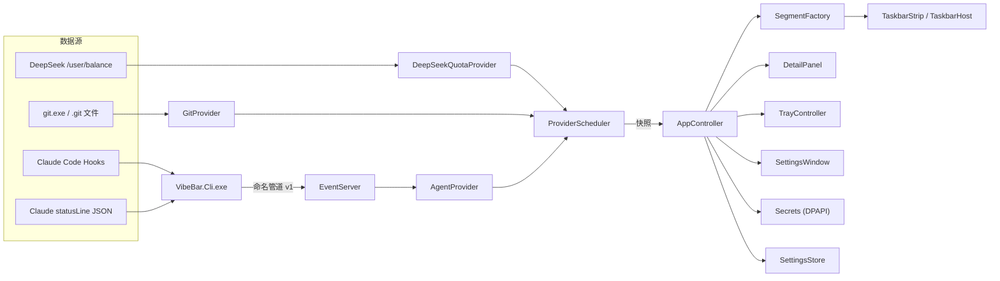

# VibeBar 架构与接口规范（v1.0 · 冻结）

> 本文是实现阶段唯一依据。子 Agent **不得**修改本文定义的顶层架构、模块边界、数据契约与 IPC 协议；需要变更时先停下并报告主 Agent。
>
> 配套文档：《功能设计.md》《验收与测试.md》
> 参考实现（只参考、不直接复制）：`E:\Acode\外设电量监控`

---

## 一、技术约束（不可协商）

| 项 | 约束 |
|---|---|
| 运行时 | .NET Framework 4.8 |
| 编译器 | `%WINDIR%\Microsoft.NET\Framework64\v4.0.30319\csc.exe`（本机无 dotnet SDK / MSBuild） |
| 语言 | **C# 5**：禁止字符串插值 `$""`、`?.`、`nameof`、表达式体成员、自动属性初始化器、元组、`using static` |
| UI | WPF，**全部用代码构建**，不使用 XAML（csc 无法编译 XAML） |
| 依赖 | 只用 .NET Framework 自带程序集，不引入 NuGet / 第三方 DLL |
| 进程 | `VibeBar.exe`（WPF，winexe） + `VibeBar.Cli.exe`（控制台，供 Hooks 调用） |
| 位数 | anycpu；与 64 位 Explorer 的 SetParent 已由旧工具验证可行 |
| DPI | `app.manifest` 使用 `PerMonitorV2` |

**编译器引用**（主程序）：

```
System.dll
System.Core.dll
System.Drawing.dll
System.Windows.Forms.dll
System.Xaml.dll
System.Web.Extensions.dll
System.Security.dll
<NET48>\WindowsBase.dll
<NET48>\PresentationCore.dll
<NET48>\PresentationFramework.dll
```

---

## 二、目录与模块边界

```
任务栏工具/
├─ build.bat                     # 一键编译两个 exe
├─ docs/
│  ├─ 功能设计.md
│  ├─ 架构与接口.md              # 本文
│  ├─ 验收与测试.md
│  └─ reports/                   # 子 Agent 每次任务的交付报告
├─ src/
│  ├─ app.manifest
│  ├─ Program.cs                 # 入口、单实例、WPF Application
│  ├─ AppController.cs           # 总装配：设置、调度、UI、托盘、生命周期
│  ├─ Models.cs                  # 所有数据契约（见第四节）
│  ├─ NativeMethods.cs           # Win32 P/Invoke
│  ├─ Log.cs                     # 轮转日志 + 脱敏
│  ├─ Json.cs                    # JavaScriptSerializer 封装
│  ├─ Theme.cs                   # 深浅色判断与订阅系统主题变化
│  ├─ UiTheme.cs                 # 颜色、字体、圆角、间距
│  ├─ TaskbarHost.cs             # WPF 透明子窗口 + 任务栏挂载/定位
│  ├─ TaskbarStrip.cs            # 段布局与悬停背景
│  ├─ DetailPanel.cs             # 独立无激活置顶详情窗口
│  ├─ TrayController.cs          # NotifyIcon + 菜单
│  ├─ SettingsStore.cs           # settings.json 读写
│  ├─ Secrets.cs                 # DPAPI 凭证
│  ├─ Providers/
│  │  ├─ IProvider.cs            # 数据源契约
│  │  ├─ ProviderScheduler.cs    # 轮询、退避、超时、隔离
│  │  ├─ DeepSeekQuotaProvider.cs
│  │  ├─ GitProvider.cs
│  │  └─ AgentProvider.cs        # 会话状态聚合
│  ├─ Segments/
│  │  ├─ SegmentVisual.cs        # UI 只认这个视图模型
│  │  ├─ SegmentFactory.cs       # 快照 → 视图模型
│  │  └─ PeakValley.cs           # 峰谷判断
│  ├─ EventBus/
│  │  ├─ EventProtocol.cs        # 两端共享，不含 WPF
│  │  ├─ EventServer.cs          # 命名管道服务端
│  │  └─ HookInstaller.cs        # Claude settings.json 合并/卸载
│  └─ Cli/
│     └─ CliMain.cs              # VibeBar.Cli.exe 入口
└─ bin/                          # 构建产物
```

**边界规则**

- `Providers/*` 不得引用 `System.Windows.*`；只产出快照。
- `Segments/*` 不得发网络请求或读文件。
- `TaskbarHost` / `TaskbarStrip` / `DetailPanel` 不得直接调用 Provider。
- `EventProtocol.cs` 必须能被主程序与 CLI 同时编译，且只依赖 `System`。
- 新增文件必须落在上述目录内，并在交付报告中说明；不得新建平行架构。

---

## 三、运行时架构



**线程模型**

- UI 线程：WPF 窗口、动画、托盘交互。
- Provider：`Task` + `ThreadPool`，自带超时；结果经 `Dispatcher.BeginInvoke` 回到 UI。
- EventServer：独立后台线程，单实例命名管道；收到事件只更新内存状态并触发回调，不做网络/磁盘重活。
- 任一 Provider 抛异常/超时只影响自己的段，必须被 `ProviderScheduler` 捕获并转成 `SnapshotHealth.Error`。

---

## 四、数据契约（冻结）

所有时间内部使用 **UTC**（`DateTime.Kind = Utc`），显示时转本地/配置时区。所有类为 `internal sealed`，字段/属性二选一但不得改名。

### 4.1 枚举

```csharp
internal enum SegmentKind { Quota, Git, Agent }
internal enum SnapshotSource { Official, LocalLog, Experimental, None }
internal enum SnapshotHealth { Live, Stale, Error, Unavailable }
internal enum AgentState { Idle, Thinking, Tool, WaitingPermission, WaitingQuota, Done, Error, Unknown }
internal enum ColorRole { Neutral, Accent, Warning, Critical, Waiting, Success }
```

### 4.2 QuotaSnapshot

```csharp
internal sealed class QuotaSnapshot
{
    public string ProviderId;       // "deepseek"
    public string DisplayName;      // "DeepSeek"
    public decimal? Balance;        // 总额，null = 未知
    public string Currency;         // "CNY" / "USD"
    public decimal? GrantedBalance;
    public decimal? ToppedUpBalance;
    public bool IsAvailable;        // 接口 is_available
    public bool IsOffPeak;          // 当前是否谷时
    public DateTime NextTransitionUtc;
    public DateTime UpdatedUtc;
    public SnapshotHealth Health;
    public SnapshotSource Source;   // Official
    public string Error;            // 人类可读，空表示无错误
}
```

### 4.3 GitSnapshot

```csharp
internal sealed class GitSnapshot
{
    public string RepoPath;
    public string RepoName;
    public string Branch;           // detached 时为空
    public bool IsDetached;
    public int StagedCount;
    public int ModifiedCount;
    public int UntrackedCount;
    public int ConflictCount;
    public int Ahead;
    public int Behind;
    public string Operation;        // "" / "merge" / "rebase" / "cherry-pick" / "bisect"
    public DateTime UpdatedUtc;
    public SnapshotHealth Health;
    public string Error;
}
```

`DirtyCount = StagedCount + ModifiedCount + UntrackedCount`（只读计算属性）。

### 4.4 AgentSnapshot

```csharp
internal sealed class AgentSnapshot
{
    public string SessionId;
    public string ProjectName;      // cwd 的目录名
    public string Cwd;
    public AgentState State;
    public string CurrentTool;      // PreToolUse 的 tool_name，可空
    public string Model;            // 来自 statusLine，可空
    public double? ContextUsedPercent;
    public DateTime StartedUtc;
    public DateTime LastEventUtc;
    public bool IsStale;            // 超过 10 分钟无事件
    public DateTime UpdatedUtc;
    public SnapshotHealth Health;
    public string Error;
}
```

### 4.5 SegmentVisual（UI 唯一输入）

```csharp
internal sealed class SegmentVisual
{
    public SegmentKind Kind;
    public string Glyph;            // 单字符/短符号
    public string Text;             // 例如 "¥23.4 谷"
    public string Tooltip;
    public ColorRole Role;
    public bool Pulse;              // 等待确认/严重告警
    public int Priority;            // 越小越靠左
}

internal sealed class DetailSection
{
    public string Title;
    public string[] Lines;
    public DetailAction[] Actions;  // 可为空数组
}

internal sealed class DetailAction
{
    public string Label;
    public Action Handler;          // UI 线程执行
}
```

### 4.6 ProviderResult

```csharp
internal sealed class ProviderResult
{
    public string ProviderId;
    public object Snapshot;         // QuotaSnapshot / GitSnapshot / AgentSnapshot
    public SnapshotHealth Health;
    public string Error;
    public DateTime UpdatedUtc;
}
```

---

## 五、Provider 契约

```csharp
internal interface IProvider
{
    string Id { get; }                    // "quota.deepseek" / "git" / "agent"
    TimeSpan PollInterval { get; }
    TimeSpan Timeout { get; }
    Task<ProviderResult> QueryAsync(CancellationToken token);
    void Dispose();
}
```

- `QueryAsync` 必须无 UI 依赖、可取消、不得写全局状态。
- 网络请求超时 10s；git 命令超时 5s；取消时抛 `OperationCanceledException` 由调度器吞掉。
- Provider 自己负责把异常转成 `ProviderResult`（`Health = Error`，`Error` 为中文短句）；调度器再兜一层。
- `AgentProvider` 例外：不轮询（`PollInterval = TimeSpan.MaxValue`），由事件驱动；`QueryAsync` 只返回当前聚合快照。

**调度规则**

- 首次启动延迟 1s 执行，避免和窗口初始化抢资源。
- 每个 Provider 独立 `nextRunUtc`；完成后再排下一次，禁止重入（`Interlocked` 保护）。
- 失败退避：1× → 2× → 4× → 8×，上限 5 分钟；成功后恢复原间隔。
- `RefreshAll()` 立即执行所有到期/允许的 Provider；同一 Provider 运行中则跳过。

---

## 六、IPC 协议 v1（冻结）

### 6.1 管道

- 名称：`VibeBar.Events.v1`
- 服务端：`NamedPipeServerStream(..., PipeDirection.In, 1, PipeTransmissionMode.Byte, PipeOptions.None, ..., PipeSecurity)`；`.NET Framework 4.8` 没有 `PipeOptions.CurrentUserOnly`，使用仅授予当前用户 `FullControl` 的 `PipeAccessRule` 达到等价隔离
- 客户端：`VibeBar.Cli.exe`
- 消息：UTF-8 JSON，**一行一条**，以 `\n` 结束，最大 64 KB
- 无响应、无重试、无握手；连不上就退出 0
- 协议版本字段 `v` 必须为 `1`；服务端收到其他版本直接忽略并记 Debug 日志

### 6.2 信封

```json
{"v":1,"kind":"hook","ts":"2026-10-22T10:00:00Z","payload":{ ... Claude Hook JSON ... }}
```

`kind` 取值：`hook` / `statusline`。`payload` 原样透传，不在 CLI 内解析。

### 6.3 CLI 行为

```text
VibeBar.Cli.exe --hook
VibeBar.Cli.exe --statusline
```

- 读取 stdin 到 EOF，最多 64 KB；超过则截断并退出 0。
- 连接管道超时 250ms；写入超时 250ms；任何异常都静默退出 0。
- `--hook`：不得向 stdout 写任何内容。
- `--statusline`：
  1. 先把 stdin JSON 写入管道；
  2. 若 `%APPDATA%\VibeBar\statusline-original.txt` 存在且非空，用 `cmd.exe /c` 执行其中的原命令，转发同一份 stdin，把 stdout 原样输出；
  3. 原命令超时 2s 或失败时输出空，不报错。
- CLI 启动目标 <30ms；不得引用 WPF、不得读配置外的文件。

### 6.4 事件映射（AgentProvider 内部）

| Hook `hook_event_name` / `notification_type` | 状态 |
|---|---|
| `SessionStart` | `Idle`，记录 cwd/session_id/start |
| `UserPromptSubmit` | `Thinking` |
| `PreToolUse` | `Tool`，记录 `tool_name` |
| `PostToolUse` | `Thinking` |
| `PermissionRequest` | `WaitingPermission` |
| `Notification` + `permission_prompt` / `agent_needs_input` | `WaitingPermission` |
| `Notification` + `idle_prompt` | `Idle` |
| `Notification` + `agent_completed` | `Done` |
| `Notification` + `quota_auto_resume_*` | `WaitingQuota` |
| `Stop` | `Done`（30s 后回 `Idle`） |
| `SessionEnd` | 移除会话 |
| 其他 | 不改状态，只更新 `LastEventUtc` |

容错：缺少 `notification_type` 时，用 `message` 是否包含 `permission` / `approve` / `allow` 判断；仍无法判断则记为 `Unknown`，不得崩溃。

---

## 七、配置与凭证

### 7.1 文件位置

```
%APPDATA%\VibeBar\settings.json
%APPDATA%\VibeBar\secrets.dat        # DPAPI 密文，base64
%APPDATA%\VibeBar\statusline-original.txt
%APPDATA%\VibeBar\log.txt
```

### 7.2 settings.json（v1 冻结 schema）

```json
{
  "version": 1,
  "general": {
    "showTaskbar": true,
    "theme": "system",
    "autoStart": false,
    "privacyMode": false
  },
  "quota": {
    "provider": "deepseek",
    "baseUrl": "https://api.deepseek.com",
    "readKeyFromClaudeSettings": false,
    "refreshSeconds": 60,
    "warnBelow": 20,
    "criticalBelow": 5,
    "peakValley": {
      "timeZone": "China Standard Time",
      "weekendOffPeak": true,
      "peakWindows": [
        { "start": "09:00", "end": "12:00" },
        { "start": "14:00", "end": "18:00" }
      ]
    }
  },
  "git": {
    "repoPath": "",
    "includeUntracked": true,
    "pollSeconds": 30
  },
  "agent": {
    "enabled": true,
    "staleMinutes": 10
  },
  "ui": {
    "maxWidth": 420,
    "minWidth": 120,
    "offsetX": 8,
    "showQuota": true,
    "showGit": true,
    "showAgent": true,
    "hoverColor": "",
    "hoverOpacity": 235
  },
  "hooks": {
    "installed": false,
    "statusLineInstalled": false
  }
}
```

规则：

- 未知键保留（读-改-写时不得丢）。
- 缺失键用默认值补齐；类型错误回退默认并记日志。
- 写入采用「临时文件 + 替换」，UTF-8 无 BOM。
- API Key **绝不**写入 settings.json。

### 7.3 凭证

- 键名：`deepseek.apiKey`
- `ProtectedData.Protect(..., DataProtectionScope.CurrentUser)` → base64 → `secrets.dat`
- 解密失败视为未配置，提示重新输入；不得记录明文或密文。
- 可选：`readKeyFromClaudeSettings = true` 时，运行时读取 `%USERPROFILE%\.claude\settings.json` 的 `env.ANTHROPIC_AUTH_TOKEN`，**只在内存中使用**，不复制到 secrets.dat。

---

## 八、DeepSeek Provider 细则

1. **端点**：`GET {baseUrl}/user/balance`；`baseUrl` 规范化：
   - 去掉尾部 `/`；
   - 若含 `/anthropic`，截断到域名根（`https://api.deepseek.com`）。
2. **请求头**：`Authorization: Bearer <key>`、`Accept: application/json`。
3. **超时**：10s；不复用连接（`KeepAlive=false`）。
4. **响应**：

```json
{
  "is_available": true,
  "balance_infos": [
    {"currency": "CNY", "total_balance": "110.00", "granted_balance": "10.00", "topped_up_balance": "100.00"}
  ]
}
```

5. **选币**：优先 `CNY`，否则第一条；金额用 `decimal.Parse(..., CultureInfo.InvariantCulture)`。
6. **状态**：
   - 无 Key → `Unavailable`，`Error = "未配置 API Key"`，不请求。
   - 401/403 → `Error`，`"API Key 无效或已过期"`。
   - 超时 → `Error`，`"请求超时"`。
   - 非 2xx → `Error`，`"HTTP " + 状态码`。
   - JSON 异常 → `Error`，`"响应格式异常"`。
   - 连续失败 ≥3 次 → `Stale` 并保留上次余额。
7. **轮询**：60s；失败退避。
8. **峰谷**：见第九节。

---

## 九、峰谷判断

- 依据：DeepSeek V4 系列自 2026-08 起启用的峰谷定价（高峰价约为空闲价的 2 倍），规则全部可配置；实际以官方价格页为准。
- 时区：`TimeZoneInfo.FindSystemTimeZoneById(config.timeZone)`，失败回退本地时区。
- 默认规则（北京时间）：
  - 工作日（周一至周五）**09:00–12:00、14:00–18:00 为峰时**；
  - 工作日其余时间为谷时；
  - 周六、周日全天为谷时（`weekendOffPeak = true`）；
  - 12:00–14:00 是谷时（午间空闲）。
- 判断顺序：UTC → 配置时区时间；若周末且 `weekendOffPeak` → 谷；否则若落在任一 `peakWindows` 区间内 → 峰；否则 → 谷。
- 区间支持跨午夜（如 22:00–02:00）：起点 ≤ 终点按普通区间，起点 > 终点按跨日区间处理。
- `NextTransitionUtc`：从当前时刻向后最多查 8 天，找到下一个峰/谷切换边界（含周末→周一 09:00 的切换）。
- 段上的「峰 / 谷」与面板倒计时由 `AppController` 的 1s 定时器重新计算，**不得依赖 60s 的余额轮询**，否则边界会延迟最多 1 分钟。
- 展示：
  - 段：`¥23.4 谷` 或 `¥23.4 峰`；
  - 面板：`当前谷时 · 距离峰时 2h 13m`。
- 只显示「峰 / 谷」，不展示折扣比例，避免价格变动导致文案过期。
- 若配置非法（时间格式/时区错误/空数组）：回退默认规则并记日志，不崩溃。
- 节假日：MVP 不处理；后续可增加 `holidays.json`（P2，默认关闭）。

---

## 十、Git Provider 细则

- 仓库来源（MVP）：`settings.git.repoPath`；为空时使用最近一次 Hook 事件的 `cwd` 向父级查找 `.git`。
- 命令（隐藏窗口、UTF-8、5s 超时、超时杀进程）：

```
git -C "<repo>" status --porcelain=v2 --branch --untracked-files=<normal|no>
```

- 解析：
  - `# branch.head <name>` → Branch；值为 `(detached)` → IsDetached。
  - `# branch.ab +N -M` → Ahead/Behind。
  - `1 XY ...` / `2 XY ...`：X/Y 非 `.` 计为 staged/modified。
  - `u ...`：ConflictCount++。
  - `? path`：UntrackedCount++。
- 监听：`FileSystemWatcher` 监听 `.git`（HEAD、index、refs）；500ms 防抖；兜底 30s 轮询。为感知工作区普通文件修改/新增，可额外监听工作区并过滤 `.git` 路径；监听创建失败或缓冲区溢出时降级为纯轮询，不得崩溃。
- **必须**为 `git status` 设置 `GIT_OPTIONAL_LOCKS=0`、`GIT_TERMINAL_PROMPT=0`、`GIT_PAGER=cat`：否则 `git status` 会刷新并写回 `.git/index`，触发 `.git` 监听 → 再次 `git status` 的自激循环（实测可达到每秒 2 次查询）。
- `.git` 为文件（worktree）：读取 `gitdir: <path>`，监听目标目录。
- 非仓库 / git 不存在 → `Unavailable`，`Error` 明确；面板隐藏该段详情，不显示 0。
- 段文本：`main*3`，detached 为 `detached*3`；ahead/behind 非零时追加 `↑2↓1`；冲突时 `main!2` 并使用 `Critical`。

---

## 十一、Agent Provider 细则

- `EventServer` 在后台线程循环 `WaitForConnection`，每个连接只读一行；读完立即断开。
- 会话字典 `session_id → SessionState`；无 `session_id` 的事件直接忽略。
- `CurrentSession` = `LastEventUtc` 最大的会话；`WaitingPermission` 的会话优先展示。
- `Done` 状态保持 30s，然后回 `Idle`；由 AppController 的 1s 定时器推进。
- 超过 `staleMinutes`（默认 10）无事件：`IsStale = true`，状态保留；不自动删除。
- 段文本：
  - `WaitingPermission` → `等待确认` + 蓝色呼吸
  - `WaitingQuota` → `额度等待`
  - `Thinking` → `思考中`
  - `Tool` → 工具名（如 `Bash`）
  - `Done` → `完成`
  - 多会话 → `2 会话 · 等待确认`
- 点击段打开详情面板；面板列出所有会话（项目名、状态、最后事件时间），不提供强制跳转。

---

## 十二、Hooks 安装器

- 目标：`%USERPROFILE%\.claude\settings.json`。
- 备份：同目录 `settings.json.vibebar.<yyyyMMddHHmmss>.bak`。
- 插件条目（沿用本机已验证的 schema）：

```json
{
  "matcher": "",
  "hooks": [
    {
      "type": "command",
      "command": "C:\\完整路径\\VibeBar.Cli.exe",
      "args": ["--hook"],
      "timeout": 5
    }
  ]
}
```

- 安装事件：`SessionStart`、`UserPromptSubmit`、`PreToolUse`、`PostToolUse`、`PermissionRequest`、`Notification`、`Stop`、`SubagentStart`、`SubagentStop`、`SessionEnd`。
- **`command` 不能带引号**：Claude Code 把 `command` 当作可执行文件名解析（不经过 shell）。带引号实测报 `Executable not found in $PATH: "\"C:\\...\\VibeBar.Cli.exe\""`。当前安装路径无空格；若用户把程序放到含空格目录，需改用 8.3 短路径或 `.cmd` 包装，禁止直接加引号。
- 幂等：识别 `command` 含 `VibeBar.Cli.exe` 的条目，先移除再插入；不得重复叠加。
- 保留其他所有键与插件 hooks；写入前用 `JavaScriptSerializer` 反序列化校验。
- 卸载：仅移除包含 `VibeBar.Cli.exe` 的条目；清理空事件数组；恢复 `statusLine`。
- statusLine：
  - 若原本不存在：写入 `{"type":"command","command":"\"...\\VibeBar.Cli.exe\"","args":["--statusline"],"timeout":5}`。
  - 若已存在且不是我们的：把原 `command` 字符串写入 `statusline-original.txt`，再替换为我们的。
  - 卸载时按 `statusline-original.txt` 恢复；无原文件则删除 `statusLine`。
- 任何写操作失败：回滚备份、返回中文错误，不崩溃。

---

## 十三、UI 规范（实现细节）

| 项 | 值 |
|---|---|
| 条高 | 内容 32px，垂直内边距 1px，总高 34px，居中于 48px 任务栏（与旧电量插件对齐） |
| 圆角 | 8px |
| 段间距 | 6px |
| 字号 | 12.5–13px，Segoe UI；数字启用 `Typography.NumeralAlignment = Tabular` |
| 非悬停背景 | alpha = 1/255 |
| 悬停动画 | 170ms，`CubicEase.EaseOut` |
| 详情面板 | 宽 360px，最大高 480px，右对齐；上弹失败则下弹 |
| 面板显示 | 延迟 150ms；移开 300ms 后收起 |
| 主题 | 浅色：文字 #1B1B1B，背景白 92%；深色：文字 #F2F2F2，背景 #202020 92% |
| 状态色 | Neutral/Accent(≈#3B82F6)/Warning(≈#B26A00)/Critical(≈#C62828)/Waiting(≈#2F6FEB)/Success(≈#1E8E3E)，深浅色分别调整 |
| 隐私模式 | 金额 → `¥•••`，路径/分支 → `…`；在 `SegmentFactory` 统一处理 |

**窗口约束**

- `TaskbarHost`：`WindowStyle=None`、`AllowsTransparency=true`、`Background=Transparent`、`ShowInTaskbar=false`、`ResizeMode=NoResize`、`SizeToContent=WidthAndHeight`、`ShowActivated=false`、`Topmost=false`；句柄创建后设置 `WS_EX_NOACTIVATE`、`Focusable=false`，启动与悬停都不得抢焦点（SetParent 后 `ShowActivated=false` 不足以保证）。
- `DetailPanel`：独立顶层窗口，`Topmost=true`、`ShowActivated=false`、`ShowInTaskbar=false`，句柄创建后设置 `WS_EX_NOACTIVATE`；**不得** `SetParent` 到任务栏。
- 面板在任务栏隐藏/全屏/Explorer 重启时必须收起；用 500ms 定时检查 `IsWindowVisible(taskbar)`（仅在面板可见时运行）。
- **DPI 换算**：WPF 的 `ActualWidth/ActualHeight/Left/Top` 是 DIP，`GetWindowRect`/`SetWindowPos`/`ScreenToClient` 使用物理像素；定位时必须乘 `VisualTreeHelper.GetDpi(this).DpiScaleX/Y`，否则 125%/150% 下会偏移或裁切。
- **宿主不透明度**：`TaskbarHost.Opacity` 必须始终为 `1`；非悬停透明只由 `TaskbarStrip` 背景的 `1/255` alpha 承担。禁止用 `Window.Opacity = 0` 隐藏宿主后再恢复——`SetParent` 之后 WPF 可能无法再更新该属性，导致文字仍在、鼠标可命中，但整窗完全透明。

---

## 十四、启动与生命周期

1. `Program.Main`：`[STAThread]`，`Mutex("VibeBar.SingleInstance")`；已存在则退出。
2. 创建 `System.Windows.Application`，设置 `ShutdownMode.OnExplicitShutdown`。
3. `AppController` 构造：加载设置/凭证 → 建 EventServer → 建 Provider/Scheduler → 建宿主/面板/托盘 → 启动。
4. 首次显示延迟到 `DispatcherPriority.ApplicationIdle`（旧工具已验证）。
5. 退出：停调度器、关事件服务、销毁托盘与窗口、释放 Mutex。
6. 未捕获异常：写日志 + 托盘气泡提示；不弹模态框。

---

## 十五、构建规范

`build.bat` 必须：

1. 检查 `csc.exe`、.NET 4.8 引用程序集、`app.manifest`。
2. 编译主程序为 `bin\VibeBar.exe`（winexe，含 manifest）。
3. 编译 CLI 为 `bin\VibeBar.Cli.exe`（console，仅 `CliMain.cs` + `EventProtocol.cs`）。
4. 任一失败返回非零并打印完整错误。
5. 成功打印两个产物路径。

---

## 十六、子 Agent 协议（硬性）

1. **只做分配的任务**；不新增指标、不改数据契约、不改 IPC、不改目录结构、不加依赖。
2. 需要新文件时，只能放在分配任务允许的目录内，并在报告中列出。
3. 每次交付必须：
   - 运行 `build.bat`，把完整输出写入 `docs/reports/<task>.md`；
   - 列出新增/修改文件与关键位置；
   - 列出未验证项与已知问题；
   - 不提交 git、不改 `docs/功能设计.md` / 本文 / `docs/验收与测试.md`。
4. 遇到规格歧义：**停止并报告**，不得自行发挥。
5. 主 Agent 审核未通过时，子 Agent 只能按评审意见修正，不得顺手重构。
